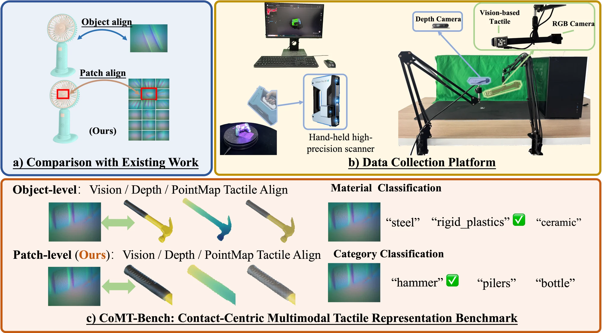

# Tac-DINO: Learning Tactile Features with Patch Alignment

[Project Page](https://lihongcs.github.io/tacdino/) · [Paper](https://arxiv.org/abs/2606.12069) · [Citation](#citation) · [Touch3D Dataset on Hugging Face](https://huggingface.co/datasets/lihong-cs/Tac-DINO) · [Data Preparation Guide](docs/touch3d-data.md) · [UniVTAC Training Guide](docs/univtac/README.md)



This repository contains Touch3D preprocessing, GeoTAC tactile encoder pretraining, and GeoTAC-initialized Diffusion Policy training on UniVTAC.

## Installation

From this directory, install the Python dependencies. Full training uses Linux with BF16-capable NVIDIA GPUs. GeoTAC additionally uses xFormers and a PointNet++ CUDA extension. Install the PyTorch 2.7.1 and torchvision 0.22.1 CUDA builds that match your system before compiling the extension. Use a matching CUDA toolkit, including `nvcc`.

```sh
python -m pip install -r requirements.txt -r requirements-preprocess.txt
# Additional dependencies for GeoTAC training
python -m pip install -r requirements-cuda.txt
python -m pip install --no-build-isolation ./third_party/pointbert/pointnet2_ops_lib
```

The existing loss and geometry tests can run on CPU with `python -m pytest -q` after installing `pytest`. Scan rendering from meshes additionally requires Blender and an HDRI directory.

## Touch3D preprocessing

Follow the [Touch3D data preparation guide](docs/touch3d-data.md) to download the original scans, regenerate views and contact correspondences, or prepare the published data for GeoTAC pretraining.

## GeoTAC pretraining

[`configs/geotac.yaml`](configs/geotac.yaml) records the paper recipe and inherits DINO/iBOT defaults from [`dinov2/configs/ssl_default_config.yaml`](dinov2/configs/ssl_default_config.yaml). It uses **10,400 optimizer steps**, 2,080 LR warmup steps, peak LR `1e-4`, cosine decay to `3.849001794597505e-6`, AdamW with betas `(0.9, 0.999)`, weight decay `0.04 → 0.2`, gradient clipping `0.4`, and a global batch size of `192` (`8 × 24`). Teacher temperature warmup is 780 steps, and the last layer is frozen for the first 26 steps. The run uses seed `20260830`, 518-pixel global crops and 98-pixel local crops.

The released recipe follows the source configuration for GeoTAC + Local VT. It uses contact-consistent matching, the additive local CLS vision–tactile loss, and the `agreement_rank` geometry objective with `anchor_pcgrad` gradient merging. The latter are implementation details of this run beyond the simplified KL expression in the manuscript.

Supply the [DINOv2 ViT-L/14 backbone without registers](https://github.com/facebookresearch/dinov2#pretrained-models) and the [ShapeNet-pretrained Point-BERT backbone](https://github.com/Julie-tang00/Point-BERT/blob/ce5a6e1f35a0d111de12c3a5e803d2b22aeec42f/README.md#pretrained-models). The trainer checks the Point-BERT SHA-256.

The paper used an object-level split of 274 training and 73 validation objects. Rebuild it from the original 347-object training list with the saved seed and category-stratification algorithm. The contact filter checks the video/annotation inventory and verifies that videos decode through the required frame. The exact generated split and original audit output were unavailable in the checkout, so the regenerated filter has not been compared with the original exclusion list.

```sh
python -m scripts.build_touch3d_split \
  --source-train-split ./data/touch3d_metadata/split0111/train_split.json \
  --output-dir ./data/splits
python -m scripts.filter_touch3d_contacts \
  --data-root ./data/touch3d --train-split ./data/splits/train_core_split.json \
  --output ./data/splits/train_contact_filter.json
```

```sh
python -m scripts.train_geotac \
  --data-root ./data/touch3d --metadata-root ./data/touch3d_metadata \
  --train-split ./data/splits/train_core_split.json \
  --contact-filter ./data/splits/train_contact_filter.json \
  --geometry-manifest ./data/derived/tactile_geometry/certified.json \
  --dino-checkpoint ./weights/dinov2_vitl14_pretrain.pth \
  --pointbert-checkpoint ./weights/pointbert_pretrained.pth \
  --output ./runs/geotac --devices 8 --batch-per-gpu 24
```

`--prepare-only` validates the inputs and writes the resolved configuration. `--stop-after N` saves a resumable checkpoint and exports teacher and student weights after step `N` without shortening the optimizer schedule. Run the command again with a higher stop step and the same output directory to continue training. An export after 1,848 optimizer steps is saved as `training/eval/training_1847/teacher_checkpoint.pth` (zero-indexed iteration). The original policy used a validation-selected export at 1,848 steps. The original run evaluated on validation every 84 steps. The training command exports at its end or a requested `--stop-after` step.

## UniVTAC post-training

Follow the [UniVTAC installation and training guide](docs/univtac/README.md) to install the policy training environment, download demonstrations, run preflight, and train or resume the GeoTAC-initialized policy.

## Citation

If you use Tac-DINO or Touch3D in your research, please cite the paper.

```bibtex
@misc{li2026tacdinolearningtactilefeatures,
  title         = {{Tac-DINO}: Learning Tactile Features with Patch Alignment},
  author        = {Hong Li and Yankang Dong and Yue Xu and Yihan Tang and Jiamin Qiu
                   and Qihang Yao and Xing Zhu and Yujun Shen and Nan Xue and Yong-Lu Li},
  year          = {2026},
  eprint        = {2606.12069},
  archivePrefix = {arXiv},
  primaryClass  = {cs.CV},
  url           = {https://arxiv.org/abs/2606.12069},
}
```

## License

Original Tac-DINO code is licensed under [Apache-2.0](LICENSE). This license covers code only. Datasets and model weights are obtained separately and are subject to their own terms.

Tac-DINO adapts [DINOv2](https://github.com/facebookresearch/dinov2) and retains its [Apache-2.0 license](licenses/DINOv2-Apache-2.0.txt). The following components retain their own licenses:

- [Scan preprocessing](dataprocess/LICENSE) (BSD-3-Clause)
- [Point-BERT](third_party/pointbert/LICENSE) and [PCT PyTorch utilities used by Point-BERT](licenses/PCT-PyTorch-MIT.txt) (MIT)
- [PointNet++ CUDA operations](third_party/pointbert/pointnet2_ops_lib/UNLICENSE) (Unlicense)
- [Diffusion Policy U-Net](dinov2/tacdino/univtac_dp/_vendor/LICENSE) (MIT)
